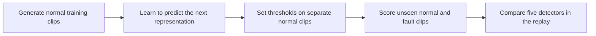

# BeltWatch Lab

**Teach a small video model what a moving conveyor looks like, then see what happens when the belt stops.**

BeltWatch learns from normal synthetic footage and scores jams, reversals, and debris without seeing examples of those faults during training. It runs on a CPU. The browser replay lets you inspect the footage, move through each frame, and compare five detectors on the same clip.

[Open the demo](https://sandeshbagmare.github.io/beltwatch-lab/) · [Read the project story](docs/ARTICLE.md) · [Inspect the results](docs/assets/metrics.json)


A small neural network turns each frame into 16 numbers. Another network uses the previous four representations to predict the next one. A large gap between the prediction and the observed representation raises an alert. Python runs the model, and the browser plays the saved scores with each detector's own scale and threshold. The prediction objective comes from the 2026 LeWorldModel paper. [Research paper](https://arxiv.org/abs/2603.19312)

## What the experiment found

The 15,136-parameter model detected **201 of 240 simulated faults** and alerted on **7 of 80 normal clips**. A detector that assumes constant horizontal movement found every fault. Its assumption matches how the simulator moves the belt.

| Detector | Clip AUROC | Frame AP | Faults detected | Normal clips alerted |
| --- | ---: | ---: | ---: | ---: |
| Latent predictor + SIGReg | 0.927 | 0.913 | 83.8% | 8.8% |
| Same model without SIGReg | 0.487 | 0.401 | 11.7% | 10.0% |
| Repeat the previous frame | 0.497 | 0.365 | 6.7% | 10.0% |
| Extrapolate pixel changes | 0.603 | 0.380 | 19.2% | 12.5% |
| Fit a fixed horizontal shift | 1.000 | 1.000 | 100.0% | 7.5% |

SIGReg is the regularizer that encourages the learned representations to retain variation. Removing it hurt this model badly. The regularized model detected 44 of 80 debris events, its weakest result across the three fault types. [Evaluation notes](docs/EVALUATION.md)

## Run it yourself

Use Python 3.12 or 3.14. Clone the repository and create a virtual environment:

```shell
git clone https://github.com/sandeshbagmare/beltwatch-lab.git
cd beltwatch-lab
python -m venv .venv
```

Activate it in PowerShell with `.\.venv\Scripts\Activate.ps1`, or on Linux and macOS with `source .venv/bin/activate`. If activation is unavailable, use `.\.venv\Scripts\python.exe` on Windows or `.venv/bin/python` in place of `python` below. Install the CPU build of PyTorch, then the package. [PyTorch installation guide](https://pytorch.org/get-started/locally/)

```shell
python -m pip install --upgrade "setuptools>=84.1"
python -m pip install torch --index-url https://download.pytorch.org/whl/cpu
python -m pip install .
python -m beltwatch run --quick --out runs/smoke
```

Open `runs/smoke/replay.html` in a browser to check the pipeline. Use the full benchmark to compare detectors.

```shell
python -m beltwatch run --out runs/benchmark
```

Choose a new output directory each time. The reference run took about 37 seconds on an Intel i5-10300H with two CPU threads. Training and the saved replay work offline after installation.

| Output | Contents |
| --- | --- |
| `replay.html` | Self-contained clip playback, detector choices, scores, and alert thresholds |
| `snapshot.png` | Four clips beside the learned model's error traces |
| `metrics.json` | Run settings, training losses, and results for every detector |
| `model.safetensors` | Weights for the regularized neural model |

To open the reference replay locally, select **Download raw file** on its GitHub page. [Replay file](docs/assets/replay.html)

## Follow the experiment



Read about the first failed run, how the model was built, and how the generator makes the clips. [Project story](docs/ARTICLE.md) · [Method](docs/METHOD.md) · [Data card](data/README.md)

Contributors can find instructions, project context, and verification results in the repository. [AGENTS.md](AGENTS.md) · [CONTEXT.md](CONTEXT.md) · [STATUS.md](STATUS.md)

Run the test suite, linter, formatter check, and type checker from the repository root.

```shell
python -m pip install -e ".[test]"
python -m pytest --cov=beltwatch
python -m ruff check src tests browser_tests
python -m ruff format --check src tests browser_tests
ty check src
```

The browser suite tests the real controls, downloads, offline playback, and narrow layouts. It needs a separate browser installation:

```shell
python -m pip install -e ".[test,browser]"
python -m playwright install chromium
python -m pytest browser_tests -q
```

On a minimal Linux system, use `python -m playwright install --with-deps chromium` to install Chromium's system libraries too. CI runs the Chromium suite on Ubuntu alongside the Python checks on Windows and Ubuntu. The [verification notes](docs/VERIFICATION.md) describe what each check covers and what remains untested.

This benchmark uses synthetic equipment footage. Accuracy on a real conveyor, changing cameras, or gradual wear has not been measured.
