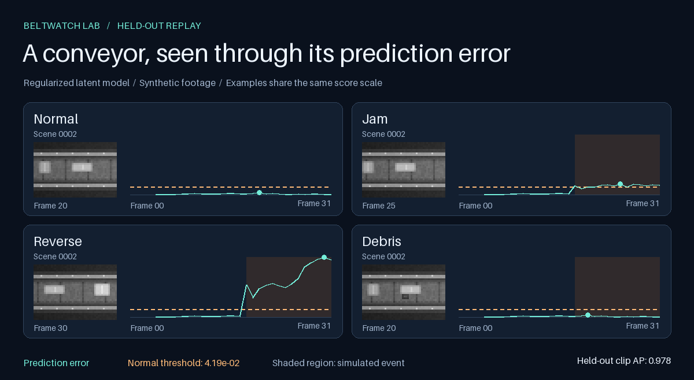
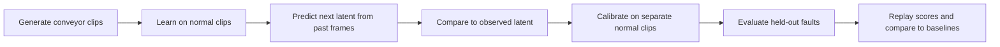

# BeltWatch Lab

**A tiny video world model for finding synthetic conveyor faults.** Train it on normal clips, then replay jams, reversals, and appearance defects to see where its next-frame expectations break.

BeltWatch runs on a CPU, generates its own footage, and opens an interactive replay in your browser. The model implements the end-to-end latent prediction and Gaussian regularization rule from the 2026 [LeWorldModel paper](https://arxiv.org/abs/2603.19312), with a compact encoder and no equipment control inputs.



[Download the standalone replay](docs/assets/replay.html) (use **Download raw file** on GitHub and open the saved HTML). The [reference metrics](docs/assets/metrics.json) and [benchmark notes](docs/EVALUATION.md) explain how the results were obtained.

## Reference results

The 15,136-parameter model trained on 160 normal scenes. On 80 unseen scenes, it detected **83.8%** of faults and alerted on **8.8%** of nominal clips. Each test scene includes a matched normal, jam, reverse and debris clip.

| Method | Clip AUROC | Frame AP | Event recall | Normal clips alerted |
| --- | ---: | ---: | ---: | ---: |
| Latent predictor + SIGReg | 0.927 | 0.913 | 83.8% | 8.8% |
| Latent predictor without SIGReg | 0.487 | 0.401 | 11.7% | 10.0% |
| Repeat previous pixels | 0.497 | 0.365 | 6.7% | 10.0% |
| Extrapolate pixel changes | 0.603 | 0.380 | 19.2% | 12.5% |
| Fit a fixed horizontal pixel shift | 1.000 | 1.000 | 100.0% | 7.5% |

The pixel-shift baseline wins here because the simulator moves the belt at a constant horizontal speed. The model's weakest fault was debris (55.0% recall). The experiment shows how regularization changes a learned representation, and why a simple baseline with the right prior is hard to beat.

## Run locally

Use Python 3.12 or 3.14 and the [PyTorch CPU wheel](https://pytorch.org/get-started/locally/). In a fresh virtual environment:

```shell
python -m pip install --upgrade "setuptools>=84.1"
python -m pip install torch --index-url https://download.pytorch.org/whl/cpu
python -m pip install .
python -m beltwatch run --quick --out runs/smoke
```

Open `runs/smoke/replay.html` in a browser. For the full benchmark, run `python -m beltwatch run --out runs/benchmark`. Choose a fresh output path for each run.

| File | What it contains |
| --- | --- |
| `replay.html` | Offline, interactive playback with an aligned score trace and threshold |
| `snapshot.png` | Shareable figure drawn from the run |
| `metrics.json` | Config, training losses, calibration diagnostics and held-out scores |
| `model.safetensors` | Trained weights from the regularized neural model |

## How it works



Read the [research method](docs/METHOD.md), [evaluation protocol](docs/EVALUATION.md), [data card](data/README.md), and [architecture design](docs/superpowers/specs/2026-11-20-beltwatch-design.md). See [AGENTS.md](AGENTS.md), [CONTEXT.md](CONTEXT.md), and [STATUS.md](STATUS.md) for contribution context.

```shell
python -m pip install -e ".[test]"
python -m pytest --cov=beltwatch
python -m ruff check .
python -m ruff format --check .
ty check src
```

This is an experiment on synthetic equipment footage. It has not been validated on real equipment and should not be used as a safety system.
