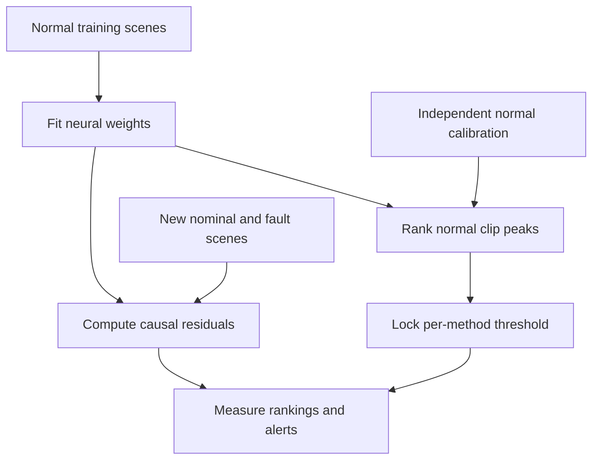

# Benchmark protocol

The default run fits on 160 normal scenes, calibrates on 72 independently generated normal scenes, and tests on 80 new scenes. Each test scene contributes one normal clip and one clip per fault type. The fault variants share their scene and pre-event frames with the normal clip. Test labels are used for metrics and the replay, never for training or threshold selection.

Development used a seed-2026 pilot for all three splits. The initial encoder nearly collapsed. We fixed the design using the pilot, froze the model and baseline choices, and set aside fresh calibration and test draws for the reference report. The split-specific seed derivation is deterministic and recorded in the output.

For each method, sort the peak per-clip scores from held-out normal calibration clips and select the one-based order statistic ceil((n + 1) × (1 − alpha)), with alpha = 0.10. Raise an alert only when a score **strictly exceeds** the threshold. Under exchangeability between normal calibration clips and a new normal clip this gives a marginal clip-level guarantee. It does not give a per-scene, frame-level or deployment guarantee. Report the actual normal test alert rate even when it exceeds the target.

| Metric | Interpretation |
| --- | --- |
| Clip AP / AUROC | Rank normal and faulty clips by their highest target-frame score; equal scores are grouped. |
| Frame AP | Rank individual scored target frames by score. Includes pre-event frames as negatives. |
| Event recall | Fraction of faulty clips with at least one alert during the labeled fault interval. |
| False alarm rate | Fraction of fully nominal test clips with at least one alert. |
| Per-fault AP/AUROC, recall, delay | Rank that fault's clips against the normal set, and report recall and median frames from event onset for detected events only. |
| Latent spread | Average per-channel standard deviation across held-out normal embeddings; near zero is a possible collapse signal. |

Results are from a procedural benchmark; correlated variants from one scene are not independent experimental runs. Clip AP depends on prevalence (fault clips are deliberately overrepresented). A sample of 80 normal clips yields a noisy false-alert estimate. The benchmark is not evidence of safety or accuracy on a real conveyor.

The checked-in [metrics](assets/metrics.json) are from the default seed 2026 and contain all method results, per-fault outcomes, and epoch losses. The run used Python 3.14.8, PyTorch 2.15.0+cpu and NumPy 2.5.5 with two CPU threads. It took about 37 seconds end to end on an Intel i5-10300H, including the ablation and replay. Runtime varies by system.

See the [browser screenshot](assets/replay-screenshot.png) to see a detected reversal in the offline replay.

The regularized model's mean channel spread was 0.947, versus 0.002 for the unregularized model. Fault recall was 96.25% for jams, 100% for reversals, and 55% for debris. The fixed-shift baseline's high scores are expected: the simulator's normal motion is almost exactly a constant translation, which the baseline estimates from warm-up frames. This controlled comparison does not establish that the learned model would generalize better to other motion regimes.

