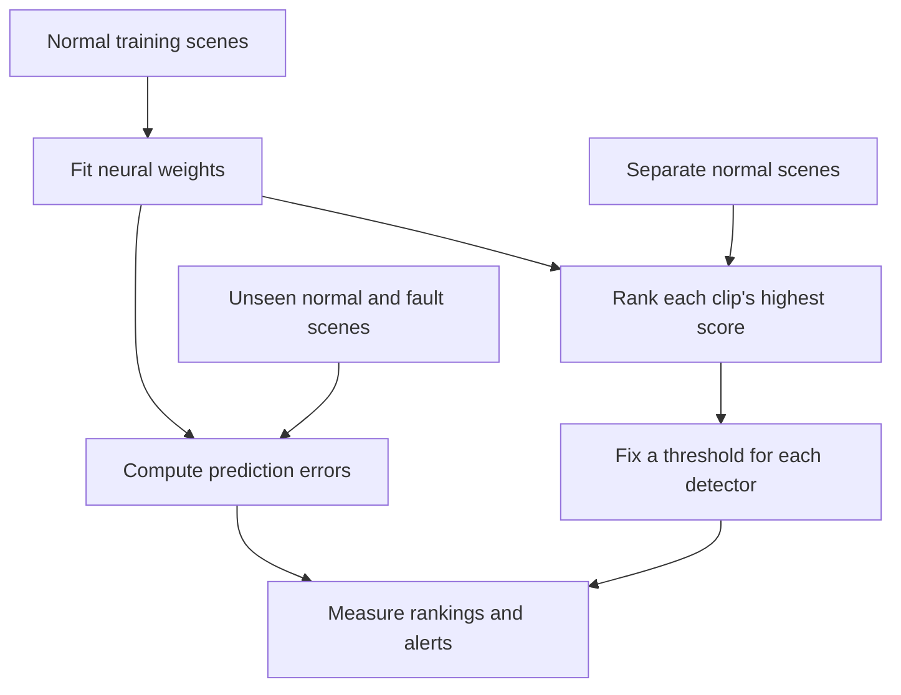

# How the benchmark is measured

The reference run learns from 160 normal conveyor scenes. Another 72 normal scenes set the alert thresholds. The test set contains 80 new scenes. Each has a normal clip and variants showing a jam, a reversal, and debris. That gives 320 test clips, including 240 with faults.

A normal clip and its fault variants share their background, lighting, noise, and frames before the event. All variants of a scene stay in the same split. Test labels are used to score the benchmark after training and threshold selection.

## Where the threshold comes from

Each detector produces 28 scores per clip after four context frames. Take the highest score from each of the 72 normal calibration clips and sort them. The target false-alert rate of 0.10 sets the threshold at rank `ceil((72 + 1) * (1 - 0.10))`, or the 66th value. An alert requires a score **strictly above** that threshold.

This is a split-conformal threshold. If the calibration clips and a new normal clip are exchangeable, the chance of alerting on that new clip is at most 10%, averaged over the calibration data and the new clip. A finite test set can still show a rate above 10%. The actual rate is reported beside recall.

## Reading the metrics

| Metric | What is counted |
| --- | --- |
| Clip AP and AUROC | Rank normal and faulty clips by their highest score. Equal scores are grouped. |
| Frame AP | Rank the scored frames individually. Frames before a fault starts count as negatives. |
| Event recall | Fraction of faulty clips with an alert during the labeled fault interval. An earlier false alert earns no credit. |
| Normal clips alerted | Fraction of entirely normal test clips with at least one alert. |
| Per-fault AP and AUROC | Rank one fault type against the normal clips. |
| Per-fault delay | Frames from the fault's onset to the first correct alert. The median includes detected events only. |
| Latent spread | Average standard deviation of the encoded channels on calibration frames. A value near zero can indicate collapse. |

AP means average precision. It depends on how common faults are in the test set, so the clip AP values here reflect a test set with 75% faulty clips. AUROC summarizes how often a faulty clip ranks above a normal one. A score of 0.5 indicates chance ordering and 1.0 indicates perfect separation. Use recall and the normal alert rate to judge the chosen threshold.

## Reference run

The regularized model detected 201 of 240 faults and alerted on 7 of 80 normal clips. Its clip AUROC was 0.927 and frame AP was 0.913. The run file records settings, epoch losses, and results for every detector. [Saved metrics](assets/metrics.json)

| Fault | Detected | Recall |
| --- | ---: | ---: |
| Jam | 77 / 80 | 96.25% |
| Reverse | 80 / 80 | 100% |
| Debris | 44 / 80 | 55% |

The regularized model's mean channel spread was 0.947. The model trained without SIGReg had a spread of 0.002 and detected only 11.7% of faults. That is evidence that collapse matters in this setup, although one seed does not establish how reliably every training run will behave.

The fixed-shift detector found all 240 faults, with alerts on 6 of 80 normal clips. Its motion assumption almost exactly matches this renderer. A benchmark with unfamiliar motion would be needed to compare how the detectors adapt.

The reference used Python 3.14.8, PyTorch 2.15.0+cpu, and NumPy 2.5.5 with two CPU threads. The original run took about 37 seconds on an Intel i5-10300H, including both neural models and report generation. A second run reproduced the original metrics, replay, and figure byte for byte in that environment. Runtime and numerical results can differ across systems.

## Development and limits

The seed-2026 development pilot exposed a nearly collapsed encoder. Group normalization within each frame and residual prediction were selected using that pilot. After freezing those choices, fresh calibration and test draws were used for the reference report. The output records seed `2026` for training, `1073743850` for calibration, and `2147485674` for testing.

The test scenes come from one procedural generator. Variants of the same scene are correlated, and the 80 normal clips give a noisy estimate of the false-alert rate. No real equipment footage, moving cameras, gradual wear, or unfamiliar fault types were evaluated. Claims about those conditions would need a separate benchmark.

The replay lets you inspect one paired scene and switch between saved detector scores. Training and inference run in Python. The score axis and threshold change with the selected detector because the error values use different scales. For the complete picture, compare the example with the aggregate results. [Replay](assets/replay.html) · [Reversal screenshot](assets/replay-screenshot.png)
