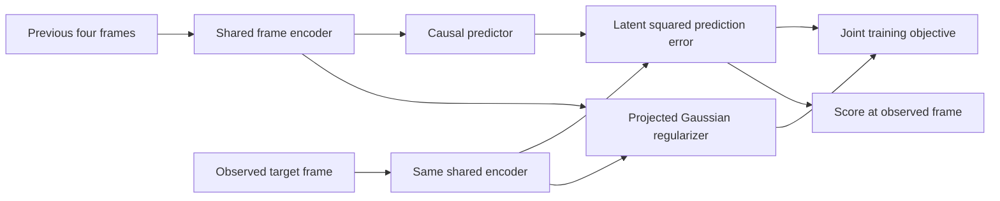

# Method and research

**Question.** Can an end-to-end representation trained only on normal equipment footage identify unexpected motion better than simple pixel baselines?

The implementation adapts the training rule from [Maes et al., *LeWorldModel* (March 2026 preprint, revised June 2026)](https://arxiv.org/abs/2603.19312). A shared frame encoder maps each image to a latent vector. A causal predictor sees four previous embeddings and estimates the next one. The observed next image goes through the same encoder. Its embedding is the prediction target, and both branches receive gradients.

The objective is mean squared next-embedding error plus a weighted **Sketched Isotropic Gaussian Regularizer**, or SIGReg. SIGReg draws unit projection directions, estimates the cosine and sine parts of each projected distribution's characteristic function, and uses weighted trapezoidal quadrature to penalize distance from the standard normal characteristic function. This makes a collapsed embedding distribution costly. The code omits the paper's action conditioning, larger architecture, and planning loop. This experiment neither uses its weights nor reproduces its reported results.

[Kuhn et al., *LeVJEPA* (August 2026 preprint)](https://arxiv.org/abs/2608.27395) independently studies the same Gaussian regularizer in a video pretraining setting with augmented views. BeltWatch implements the forecasting objective above; it does not implement LeVJEPA's view-invariance or token-dropping recipe. [Wang, Tamura and Yamamoto (July 2026)](https://doi.org/10.3390/s26134314) study fine-grained video anomaly detection from normal videos; our simulator instead reserves all generated fault clips for evaluation.

The CNN uses group normalization within each frame, so encoding one frame cannot reveal information about later frames. The predictor learns a residual correction on top of the last observed embedding. The neural score is mean squared latent prediction error at the target frame. Clip ranking uses the maximum available score. The ablation trains the same architecture from the same seed with the regularizer disabled.

The three pixel baselines predict a repeated frame, a clipped linear extrapolation, or a translated previous frame. The last baseline selects a signed translation within three pixels from the four warm-up frames and holds it fixed. It does not receive the simulator's speed, but its prior matches the simulator. Each method gets its own threshold.

Read the [benchmark protocol](EVALUATION.md) for metric definitions and the [data card](../data/README.md) for split construction.
