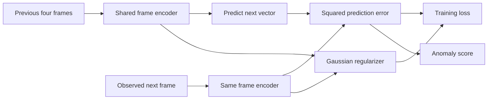

# Learning what should happen next

Suppose the last few frames show parcels moving steadily to the right. A useful model should expect more of that movement. If the next frame shows a stopped belt or reversed motion, the mismatch gives us a possible fault signal.

BeltWatch makes that comparison in a learned representation. The encoder maps each 32-by-48 grayscale frame to a vector of 16 values. A predictor takes four consecutive vectors and estimates the fifth. Once that frame arrives, the same encoder produces the observed vector. Their mean squared difference is the score for that frame.

## Keeping the representation useful

The encoder can lower prediction error by giving every frame almost the same vector. The predictor then makes few errors while learning very little about the video. The first development run showed this failure, and the version trained without regularization still does.

The training loss adds a **Sketched Isotropic Gaussian Regularizer**, or SIGReg, to the prediction error. SIGReg encourages the vectors to have a standard Gaussian distribution, making a constant representation costly. It samples 32 unit projection directions, measures how the projected values differ from a standard normal distribution, and averages the penalties. The implementation estimates that distance from cosine and sine averages using 17 quadrature points between 0 and 3. The prediction and regularization terms each have weight 1.0 in the reference run.

Both sides of the prediction loss receive gradients. The model uses a three-layer CNN with group normalization inside each frame, followed by a linear projection. Its predictor is a small multilayer perceptron that learns a correction to the most recent vector. Processing each frame independently keeps later pixels out of earlier forecasts. The tests check this directly by changing target and future frames and confirming that the earlier forecast stays the same.

## What comes from the research

Maes et al. jointly train an encoder and a predictor with next-embedding error and Gaussian regularization. BeltWatch takes that objective and trains a small CNN from scratch on synthetic equipment footage. The paper studies action conditioning and planning with a larger architecture, while BeltWatch measures fault detection using video alone. [LeWorldModel, March 2026, revised June 2026](https://arxiv.org/abs/2603.19312)

Kuhn et al. study Gaussian regularization for video representation learning with augmented views and token dropping. Wang, Tamura, and Yamamoto study fine-grained video anomaly detection learned from normal videos. BeltWatch uses the LeWorldModel objective and reserves every generated fault clip for evaluation. [LeVJEPA, August 2026](https://arxiv.org/abs/2608.27395) · [Fine-grained video anomaly detection, July 2026](https://doi.org/10.3390/s26134314)

## Five detectors, one set of clips

The benchmark compares the regularized model with four alternatives. Each uses the same observed footage and gets a threshold from separate normal calibration clips.

| Detector | How it predicts the next observation |
| --- | --- |
| Latent predictor + SIGReg | Uses the last four encoded frames and learns with the full loss. |
| Latent predictor without SIGReg | Uses the same architecture, initial weights, and minibatch order, with the regularizer disabled. |
| Repeat the previous frame | Assumes that pixels stay where they are. |
| Extrapolate pixel changes | Extends the previous pixel difference, clipping the result to the valid intensity range. |
| Fit a fixed horizontal shift | Estimates a shift from -3 to +3 pixels using the first four frames, then holds it fixed. |

The fixed-shift detector estimates speed from pixels. Its constant-motion assumption fits the generator closely, which explains its strong result. A jam can produce a smaller frame-difference score because successive frames look nearly identical.

Raw score values belong to their own detector's scale. Compare each trace with its own threshold, or compare the ranking and alert metrics across detectors. [Evaluation protocol](EVALUATION.md) · [Data card](../data/README.md)
