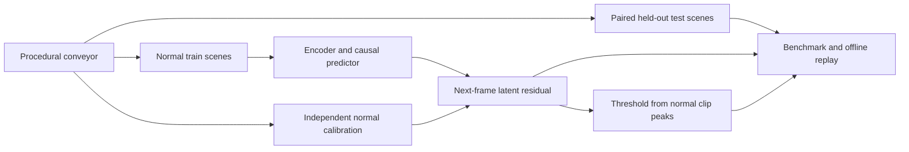

# BeltWatch Lab design

Train a compact neural network on normal synthetic conveyor runs, then measure how surprising each newly observed frame is given its recent past. Report which failure types the model misses and whether it improves on simple frame-based methods. Readers should be able to reproduce and inspect the experiment without any data downloads, real footage, GPU, or server.

- Input: grayscale generated conveyor frames with independent scenes for training, calibration and test.
- Method: jointly train a CNN and causal latent predictor with next-step mean squared error plus sketched isotropic Gaussian regularization (SIGReg), adapted from [LeWorldModel](https://arxiv.org/abs/2603.19312). No pretrained weights or action inputs. This is an adaptation rather than a benchmark reproduction.
- Evaluation: use only normal clips for model fitting and calibration. Report held-out clip AP/AUROC, threshold recall/false alarm rate, frame AP and per-fault measures. Compare against pixel difference and pixel extrapolation, with a no-SIGReg ablation.
- Demo: an offline HTML replay with nominal/fault samples, a score trace and a synthetic PNG snapshot. Store reproducible metrics separately from the demo.
- Scope: research prototype with no claim of industrial readiness, real-world coverage or published-paper performance. No personal data, live stream ingestion or device control.

